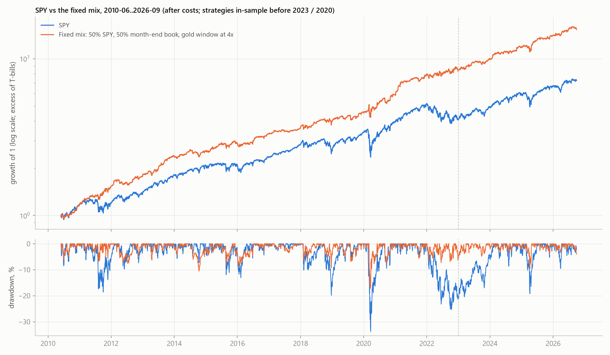
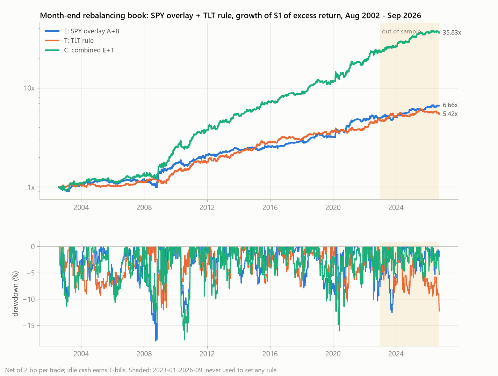
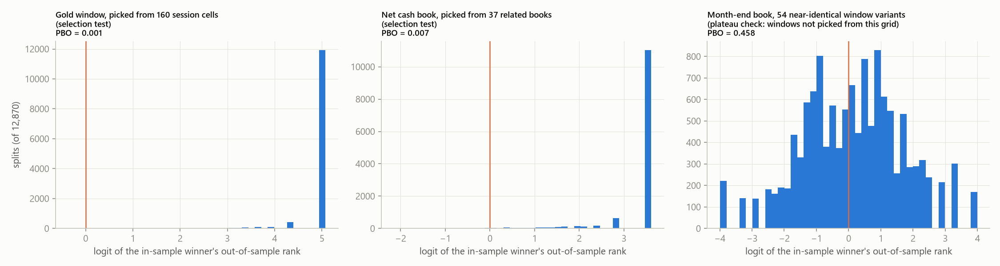
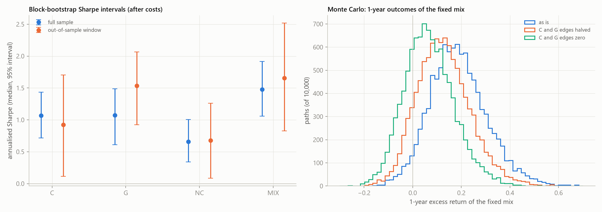

# Systematic trading research

Personal research on systematic strategies in US equities, Treasuries and futures.

**In short:**
- **The method.** Each study starts from a written plan (hypothesis, test, pass mark), committed before any result. It is judged on data held back in advance and used once.
- **The record.** Of 11 studies so far, 3 passed their sealed tests. The other 8 are reported here too, with what each ruled out.
- **The three that passed:**
  - a month-end rebalancing effect in stocks and long Treasuries;
  - a weekly session window in gold, stronger after a weak gold week;
  - a narrow effect in cash-rich stocks that holds after 2000 but not before.
- **In a portfolio.** The first two, combined with an S&P 500 core using fixed, rule-based weights, have a historical Sharpe ratio of about 1.5, against 0.8 for the index. Much of that history is in-sample; each paper says where.

Not included: licensed data, results derived from it at row level, and the exact parameters of anything traded live.

- **Method:** [METHODOLOGY.md](METHODOLOGY.md), the protocol every study follows.
- **Papers:**
  - [Month-end rebalancing flows in stocks and long Treasuries](papers/month_end_flows.md) (flagship; [PDF](papers/month_end_flows.pdf));
  - [Session seasonality in Nasdaq-100 and gold, and a weekly window in gold](papers/gold_session_window.md);
  - [Cash-rich, cash-generating stocks](papers/net_cash.md);
  - [Combining two low-correlation strategies with an equity core](papers/fixed_mix.md).
- **Notes:**
  - [replications of published strategies](studies/replications.md);
  - [negative results](studies/negative_results.md).

## Studies at a glance

Each study was run with a plan committed before the test. "Sealed" means the test data was fixed in advance and used once. Costs are included unless marked gross.

### Candidates (passed a sealed test; paper trading)

| Study | Question | Data | Result |
|---|---|---|---|
| **Month-end rebalancing flows** (SPY, TLT) | Do pension and balanced-fund rebalancing and Treasury index extension move stocks and long bonds in a predictable way around month-end? | Daily, US 1970-2026; Germany, UK, Japan, Canada | Each leg was validated on its own first. The equity rule replicates the literature on 2000-22. The bond rule was built on 2002-20 and held up on 2020-25. **The combined book, chosen in-sample on 2002-22, was then tested once on 2023-26: Sharpe 1.09 at 2 bp (0.92 under the live timing at 4 bp).** The equity leg replicates in four countries never used for design (pooled t −4.4; Canada t −5.5). Out of sample, the equity leg carried the book (Sharpe 1.01) and the bond leg was the weaker half (0.50). No effect before 2000. [Paper](papers/month_end_flows.md) |
| **Session × weekday seasonality** (Nasdaq-100 and gold futures) | Where in the 23-hour futures day do returns accrue, and does it depend on the weekday? | 1-minute futures 2010-26; even years to explore, odd years sealed | A sweep of session × weekday cells; 9 rules tested once on the odd years (Holm). **One passed: a single weekday × session window in gold** (t 4.6 net). A condition on the preceding week, frozen on 2010-19, **passed a 2020-26 hold-out** (Holm p 0.02). Capacity about $10M of gold. [Paper](papers/gold_session_window.md) |
| **Net cash firms** (US stocks) | Do cash-rich, cash-generating firms earn abnormal returns? | Compustat / CRSP 1993-2026 | Built on 1993-2015. **Frozen 2016-25 test: FF6 + q alpha +13.8%/yr (t 2.46)**, robust to realistic spreads. **A second one-time test on 1971-1992 failed** (+2.0%, t 0.86): all the evidence is post-2000. Concentrated (about 7 names, max drawdown −45%) and small-account only. [Paper](papers/net_cash.md) |
| **Fixed mix** (SPY + month-end book + gold window) | Can two low-correlation strategies be combined with an equity core without fitting weights to returns? | The books above, 2010-26 | Gold sized by a tail-loss budget; SPY and the month-end book split 50/50 (close to equal risk). A walk-forward test of five weighting schemes found **none better than the fixed weights**; the return-based optimiser was the worst. Sharpe 1.47 vs SPY 0.80, max drawdown −17% vs −34%. [Paper](papers/fixed_mix.md) |

*SPY vs the fixed mix (50% SPY, 50% month-end book, gold window at 4×): account growth and drawdowns, 2010-2026, after costs. The strategies are in-sample before 2023 and 2020.*

*Month-end book: equity leg, bond leg and combined, with the 2023-26 test shaded.*

### Closed (failed, or effect below costs)

What each failure taught is in [studies/negative_results.md](studies/negative_results.md).

| Study | Result |
|---|---|
| Overnight vs intraday returns of internationally held US stocks | Overnight returns concentrate in high-volatility, high-turnover names, but a long-overnight book's alpha after 2009 is below its costs. An opening-gap fade passed its training rule, then **failed a sealed test on 2022-26 IEX minute data** (−9.7 bp a trade). |
| Index overnight drift by volatility regime | The drift is real (+3.5 bp a night, t 4.7) but does not depend on the regime; futures costs remove it. |
| Opening-range breakouts across four futures markets | 307,557 variants. In-sample Sharpes of 1.5-2.8 became **−0.35 walk-forward**. A deflated Sharpe looked fine but was misleading (effective trials 48). |
| Opening z-score continuation (Nasdaq-100 futures) | Failed its sealed odd-year test. |
| S&P 500 deletions | Sealed test failed with the wrong sign. |
| Nasdaq-100 15-minute higher-high / higher-low pattern | No edge after costs at any horizon. |
| Published SPY dip-buying rules (IBS; linear mean reversion) | IBS: real but modest; does not reach the published Sharpe. Linear rule: replicates, but its parameters are the best of 90 neighbours (grid median Sharpe 0.58 vs 0.76). |
| Overnight share of stock returns (EDA) | A stable stock trait. Band touches behave like a random walk. Momentum is a tug of war between sessions. |

## Validation of the candidates

All figures are after costs and in excess of T-bills.

| | Month-end book | Gold window | Net cash | Fixed mix |
|---|---|---|---|---|
| **Sharpe, out-of-sample window** (95% block-bootstrap interval) | **0.92 (0.11-1.70)**, 2023-26 | **1.53 (0.92-2.06)**, 2020-26 | **0.67 (0.08-1.26)**, 2016-25 | **1.64 (0.83-2.52)**, 2023-26 (components' rules fixed beforehand; weights chosen later) |
| Sharpe, full history (includes the design period, so flattered) | 1.07 (0.72-1.44), 2002-26 | 1.07 (0.61-1.49), 2010-26 | 0.66 (0.34-1.01), 1993-2026 | 1.47 (1.06-1.92), 2010-26 |
| Probabilistic Sharpe > 0, out of sample | 0.96 | 1.00 | 0.99 | 1.00 |
| Deflated Sharpe, at the measured number of independent trials | 1.00 (54 window variants ≈ 2 independent) | 0.97 (160 session cells ≈ 150) | 1.00 (37 related books ≈ 3) | n/a: weights set by a rule fixed in advance, not searched |
| Deflated Sharpe, at a broad count of every look | 0.999 (about 50) | 0.90 (about 1,000, incl. the hourly profile and conditions) | 0.85 (about 200, incl. earlier studies on the universe) | n/a |
| Probability of backtest overfitting (CSCV) | Not a selection test here: the windows come from the literature. As a plateau check, the in-sample best of 54 window variants never lost out of sample (PBO 0.46 = the choice among near-copies is noise). | 0.001 (picked from 160 cells) | 0.007 (picked from 37 books) | n/a |

**Reading:**
- **Deflated Sharpe ratios are shown at two trial counts:** the measured number of independent trials in the family the result was picked from (a lower bound), and a broad count of every look taken (an upper bound).
- **The gold window** is not a lucky pick from the sweep: it is the top cell in almost every one of 12,870 cross-validation splits. Its deflated Sharpe is 0.97 counting the sweep's cells, 0.90 counting every look. The sealed hold-out is the real evidence.
- **The net cash book passed its 2016-25 test, but failed a second one-time test on 1971-1992.** Its deflated Sharpe at a realistic trial count is 0.85. The honest description is a post-2000, small-account effect.
- **The fixed mix** is half SPY, half month-end book, plus the gold window sized by a tail-loss budget. In a Monte Carlo of one-year outcomes, it loses money in about 1 year in 9 if both edges halve, which is the planning case, since published effects usually shrink. On the historical record, which is mostly in-sample, it loses in about 1 year in 25.

*Probability of backtest overfitting: the gold window and the net cash book stay at the top out of sample in almost every split; for the month-end book the 54 windows are near-copies, so their ranking is noise (plateau).*

*Left: block-bootstrap Sharpe intervals, full sample and out of sample. Right: one-year outcomes of the fixed mix as on the record, with both edges halved, and with no edge.*

## Disclaimer

Personal research, not investment advice. Past and simulated results do not predict future returns.
