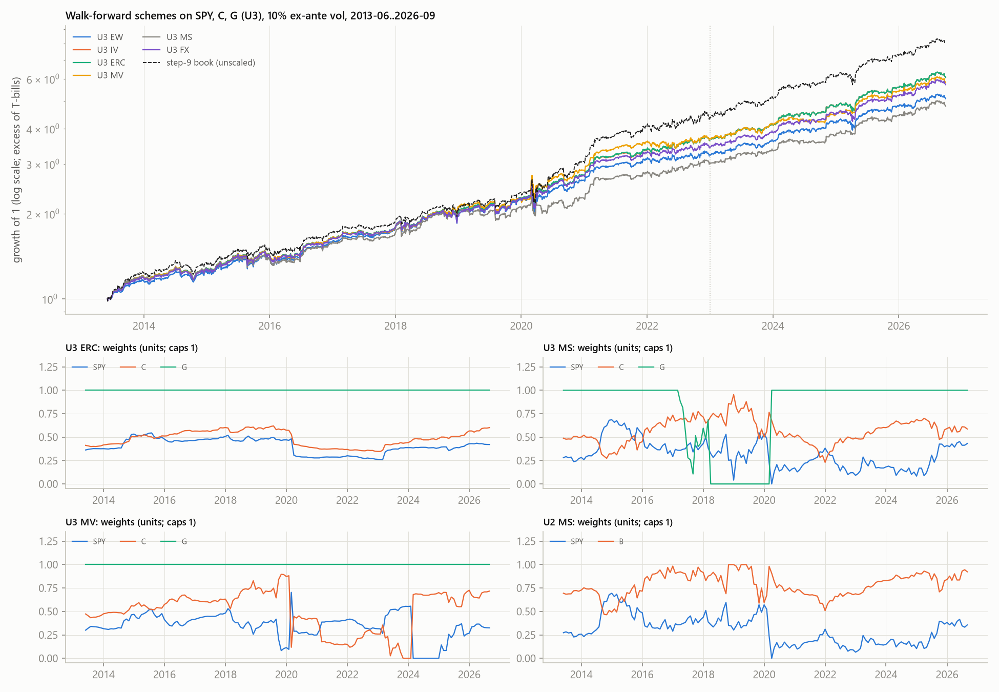
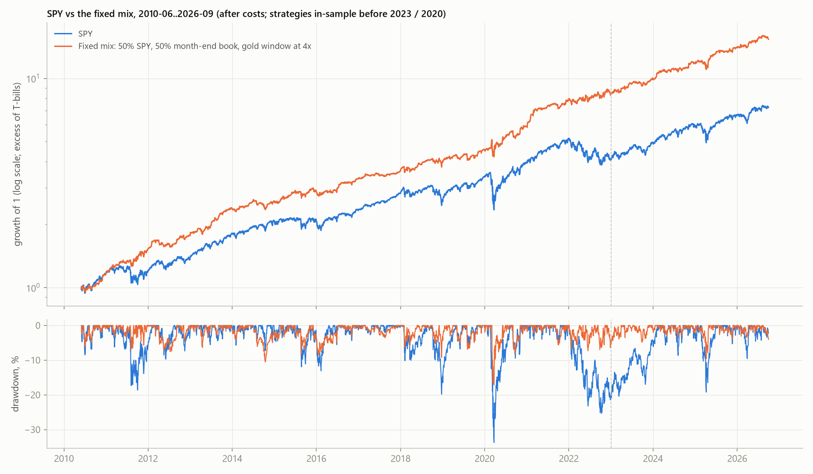
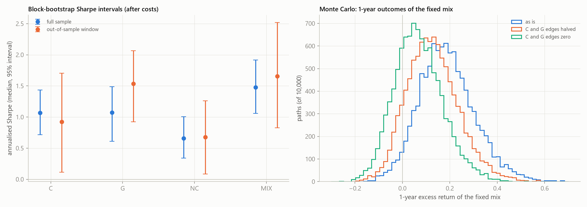

# Combining Two Low-Correlation Strategies with an Equity Core, Without Fitting the Weights

*Working paper, November 2026. Personal research; not investment advice.*

## Abstract

I combine an S&P 500 core (SPY) with two strategies that are nearly uncorrelated with it and with each other:
- **the month-end book:** a month-end stock-bond rebalancing book ([paper](month_end_flows.md));
- **the gold window:** a weekly session window in gold, after a weak gold week ([paper](gold_session_window.md)).

The weights are **not** fitted to backtested returns. Gold is sized by a tail-loss budget, and SPY and the month-end book are split equally, close to equal risk.

A walk-forward comparison of standard weighting schemes (1/N, inverse volatility, equal risk contribution, minimum variance, maximum Sharpe) finds none better than these fixed weights, and the return-based optimiser is the worst and least stable.

**The decided mix: half SPY, half the month-end book, and the gold window at four times the account.**
- **2010-2026:** a Sharpe of 1.47 against 0.80 for SPY, a −17% maximum drawdown against −34%, and no losing 12-month window.
- **2023-2026,** where both strategies' rules were fixed before the data: Sharpe 1.64.
- **Monte Carlo:** the chance of a losing year is about 4% on the historical record, 12% if both strategies' edges halve, and 26% if they vanish.
- **Capacity** is set by the gold window, at about $2.5M.

---

## 1. Introduction

Two strategies with Sharpe ratios near 1 and near-zero correlation should combine into something better than either. The difficulty is the weights: optimising them on backtested returns fits noise.
- Expected returns are the input that matters most and can be estimated least (Chopra & Ziemba 1993).
- Out of sample, naive 1/N weights are hard to beat (DeMiguel, Garlappi & Uppal 2009).

This paper builds the mix from rules that do not use returns. It then checks the rules against standard optimisers in a walk-forward comparison, with a decision rule written before the comparison was run.

## 2. The components

| Component | What it does | Unit | Correlation with the others |
|---|---|---|---|
| SPY | S&P 500 total return | 100% of the account | — |
| Month-end book C | SPY and TLT around month-end, conditional on the month's stock-bond spread | 1× per leg | SPY −0.11; gold +0.09 (monthly) |
| Gold window G | Long gold in one weekly session window, after a weak gold week | 4× the account in gold | SPY −0.18 (monthly) |

All returns are after costs and in excess of T-bills:
- 4 bp per trade for the month-end book (conservative);
- $4 per micro gold contract round trip.

**Sizing the gold window by tail loss, not by volatility:**
- The trade is a short window about 16 times a year, so its annualised volatility (2.7%) badly understates its risk.
- I size it so that a −1% gold move inside the window costs 4% of the account: 4× the account in gold.
- Per $100k of capital that is about $400k of gold, or about 9 micro contracts, recomputed each time so that dollar exposure stays constant.
- Equal-risk weighting would want far more (about 12×), where the worst window on record would cost about 10%.

## 3. How the weights were chosen

**Step 1: the two strategies together.**
- The month-end book at 0.75× per leg plus the gold window: daily correlation +0.03.
- Adding gold raises the Sharpe from 1.15 to 1.38 (2010-2026) and from 0.92 to 1.25 in 2023-2026, for about +3% a year, with the drawdown about unchanged.

**Step 2: adding the equity core.** Two ways to add SPY were compared:
- a **50/50 split** of the account between SPY and the month-end book;
- a **leveraged overlay** (100% SPY plus the month-end book at 0.5× per leg).

| 2010-2026 | Return/yr | Sharpe | Max drawdown | Worst 12 months |
|---|---|---|---|---|
| SPY | 14.7% | 0.80 | −33.8% | −18.2% |
| 50/50 SPY + month-end book | 16.7% | 1.27 | −20.2% | +4.6% |
| **50/50 SPY + month-end book, + gold** | **20.1%** | **1.47** | **−17.2%** | **+4.2%** |
| Overlay (100% SPY + book 0.5×) + gold | 27.0% | 1.26 | −30.4% | −2.7% |

- The overlay earns more but keeps SPY's drawdowns and needs leverage beyond a standard margin account.
- The 50/50 split is close to equal risk already: inverse-volatility weights would be 44/56.

**Step 3: a walk-forward test of the weighting method.**
- **Setup:**
  - every month, each scheme set weights from the trailing 36 months only;
  - weights were scaled to the same 10% ex-ante volatility;
  - gold was capped at its tail budget.
- **Evaluation:** June 2013 to September 2026.
- **Decision rule, written beforehand:** keep the fixed weights unless a scheme beats them by a bootstrap interval excluding zero.

| Scheme | Daily Sharpe | Difference vs fixed (95% interval) |
|---|---|---|
| 1/N | 1.23 | |
| Inverse volatility / equal risk contribution | 1.35 | +0.04 (−0.01 to +0.10) |
| Minimum variance | 1.29 | −0.02 (−0.19 to +0.19) |
| Maximum Sharpe (trailing means) | 1.22 | −0.08 (−0.31 to +0.12) |
| Fixed weights, scaled | 1.31 | — |
| **Fixed weights, unscaled (the decided mix)** | **1.39** | |

*Top: each scheme's account growth at 10% ex-ante volatility (U3 = SPY, month-end book and gold as separate components; EW 1/N, IV inverse volatility, ERC equal risk contribution, MV minimum variance, MS maximum Sharpe, FX fixed weights; dashed = the decided mix, unscaled). Bottom: weights over time. The maximum-Sharpe scheme drops gold in 2018-2020.*

**Findings:**
- No scheme beats the fixed weights. The return-based optimiser is the worst and the least stable: it dropped gold entirely in 2018-2020 after a flat stretch.
- Keeping gold as its own component, rather than bundled with the month-end book, matters: bundling costs 0.08-0.13 in Sharpe because gold can no longer reach its cap.
- Volatility targeting adds nothing.

**Decision:** fixed weights. SPY 0.5, the month-end book at 0.5× per leg, gold at 4×. Total size is set by drawdown tolerance.

## 4. The decided mix

| | 2010-06 to 2026-09 | 2023-01 to 2026-09 |
|---|---|---|
| Return / yr (T-bills added back) | 20.1% | 22.9% |
| Volatility | 11.9% | 10.1% |
| Sharpe, daily / monthly | 1.47 / 1.94 | 1.64 / 2.05 |
| Max drawdown | −17.2% (March 2020) | −9.6% |
| Worst month | −5.1% | −3.7% |
| Worst 12 months | +4.2% | +12.6% |

*SPY vs the decided mix: account growth (log scale, in excess of T-bills) and drawdowns, 2010-2026, after costs. The month-end book and the gold rule are in-sample before 2023 and 2020; the dashed line marks 2023.*

**What the 2023-2026 window does and does not prove.**
- It is the only stretch where both strategies' rules were fixed before the data.
- The weights themselves were chosen in November 2026, so this window is not out of sample for the weights. The walk-forward comparison is the evidence for them.

## 5. Validation

| Statistic | Value |
|---|---|
| Sharpe 2010-26, 95% stationary-bootstrap interval | 1.47 (1.06 to 1.92) |
| Sharpe 2023-26, 95% interval | 1.64 (0.83 to 2.52) |
| Probabilistic Sharpe > 0, 2023-26 | 0.999 |

The weights were not selected from a search: gold's size comes from a tail-loss budget, the 50/50 split from equal risk, and the decision rule was written before the walk-forward. So neither a deflated Sharpe nor a probability of backtest overfitting applies to the mix itself. The selection risk sits in the two strategies, covered in their papers. (The 13 weighting schemes are about one independent bet anyway: mean correlation 0.96.)

**Monte Carlo** of one- and five-year outcomes: stationary bootstrap of daily returns, 21-day blocks, 10,000 paths, returns in excess of T-bills.

| Scenario | Median 1-year | P(1-year loss) | 5th-percentile 1-year drawdown | P(5-year loss) |
|---|---|---|---|---|
| As on the record | +18% | 4% | −16% | 0.0% |
| **Both strategies' edges halved (planning case)** | **+12%** | **12%** | **−17%** | **0.3%** |
| Both edges zero (SPY half only) | +6% | 26% | −18% | 7% |

**The planning case is the halved one,** because published effects usually shrink after discovery. There is about a 1-in-5 chance of at least one day losing 4% or more within a year, whatever the scenario.

## 6. Capacity and implementation

**Capacity:**
- The gold window binds: about 23 full-size contracts (roughly $10M of gold) before orders exceed 10% of the thinnest five-minute window. That is about $2.5M of account at 4×, or $1.2M if its edge halves.
- The month-end book alone could take about $39M (TLT is the constraint).
- Above $2.5M, the gold weight has to shrink, and the mix drifts toward the plain 50/50 (Sharpe 1.27).

**Implementation:**
- **Netting:** the SPY core and the month-end trades are netted, so no long and short are held at once.
- **Margin:** at the peak the account holds 1.5× its capital in ETFs, within a standard margin account, plus the gold margin during the window.
- Positions by phase are not disclosed.

## 7. Limitations

- **Mostly in-sample history:** the month-end book before 2023 and the gold condition before 2020.
- **A bull market:** 2010-2026 was strong for SPY, which flatters every SPY-heavy mix.
- **Recent, short out-of-sample records** for both strategies; the month-end effect is absent before 2000.
- **Not modelled:** taxes, currency (for a non-US account) and margin financing.

## 8. Conclusion

Two small, independent edges and an equity core combine into a book with a materially better risk profile than the core alone, without fitting a single weight to returns. The walk-forward comparison supports the simplest choice. The Monte Carlo puts realistic bounds on what to expect if the edges shrink.

## References

- Chopra, V. K., & Ziemba, W. T. (1993). The effect of errors in means, variances, and covariances on optimal portfolio choice. *Journal of Portfolio Management* 19(2).
- DeMiguel, V., Garlappi, L., & Uppal, R. (2009). Optimal versus naive diversification: How inefficient is the 1/N portfolio strategy? *Review of Financial Studies* 22(5).
- Maillard, S., Roncalli, T., & Teïletche, J. (2010). The properties of equally weighted risk contribution portfolios. *Journal of Portfolio Management* 36(4).
- Politis, D. N., & Romano, J. P. (1994). The stationary bootstrap. *Journal of the American Statistical Association* 89.
