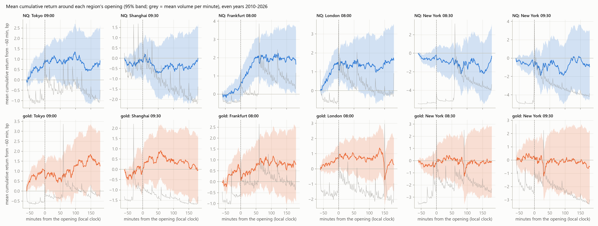
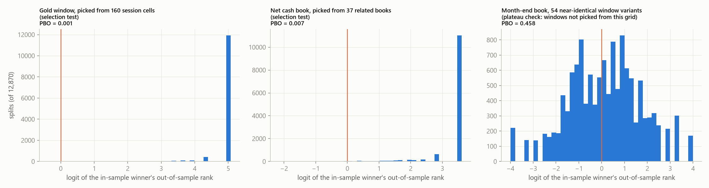

# Where the Futures Day Earns Its Return: Session Seasonality in Nasdaq-100 and Gold, and a Persistent Weekly Window in Gold

*Working paper, November 2026. Personal research; not investment advice.*

*The weekday, session window and condition threshold of the traded rule are not disclosed. They are referred to as "the gold window".*

## Abstract

I map where in the 23-hour futures day Nasdaq-100 (NQ) and gold (GC) futures earn their returns, by session and weekday, using one-minute bars from 2010 to 2026. To keep the exploration honest:
- the sample is split by **alternating years**;
- even years are explored descriptively;
- nine rules suggested by the exploration are then tested **once** on the sealed odd years, with a Holm correction.

**Findings:**
- **Nasdaq-100:** its overnight drift sits in the hour before Tokyo opens and at the European open. These and three other effects replicate gross but cost about as much as they earn.
- **One rule survives:** a long position in gold during one weekday × session window.
  - Odd years: +4.8 bp gross (t 7.0) and +3.2 bp net (t 4.6, Holm p < 0.001), positive in both eras.
- **A condition found on 2010-2019, that the window is stronger after a weak gold week,** then passed a one-shot hold-out on 2020-2026:
  - +8.2 bp against +3.2 bp on other weeks (t 2.84, Holm p 0.02);
  - better in 6 of 7 years.
- **Overfitting checks:** cross-validation across 160 session cells puts the window at the top in essentially every split (probability of backtest overfitting 0.001). The full-sample deflated Sharpe is 0.97 counting the sweep's cells (about 150 independent) and 0.90 counting every look (about 1,000), so the evidence is the sealed tests, not the full history.
- **Capacity** is about $10M of gold.
- **A 2026 drawdown teaches a sizing lesson:** hold dollar exposure constant, not contract count.

---

## 1. Introduction

Equity-index and metal futures trade from 18:00 to 17:00 New York time, through three regional sessions. Whether returns accrue evenly across that day, or in specific windows tied to who is trading, is a basic question about these markets. It also produces many candidate "seasonalities", most of which are noise.

This paper is a worked example of how to search such a space without fooling oneself:
1. explore descriptively on half the data;
2. freeze a short list of rules;
3. test them once on the other half with a multiple-testing correction;
4. treat any later refinement as a new hypothesis that needs its own unseen data.

## 2. Data and design

**Data:**
- CME Globex one-minute bars for the front NQ and GC contracts, June 2010 to September 2026, with the front month chosen by the previous session's volume.
- Each Globex session belongs to one contract, so session returns never cross a roll.
- Times are in New York time with daylight saving handled per date.

**Sessions.** The day is cut where participants change: Asia from the evening reopen, Europe, the US pre-open, the cash open hour, midday, the afternoon, the period after the cash close, and the gap from the previous close to the reopen.

**Split, fixed before any number was computed:**
- **even years** 2010-2026 for exploration;
- **odd years** 2011-2025 sealed.

Alternating years keep both the pre-2020 and post-2020 regimes in each half.

**Costs, fixed in advance:**
- full-size contracts: $2.50 a side plus one tick of slippage;
- micro contracts: about $1 a side all-in plus one tick.

## 3. Exploration (even years)

The exploration is descriptive: means, t-statistics, volatility and volume by session × weekday, an hourly profile, and openings measured in local clocks (Tokyo, Shanghai, Frankfurt, London).

**Nasdaq-100:**
- The drift is earned overnight: Asia averages +3.8 bp a day (t 3.0), and the US cash session about zero.
- In local clocks it sits in the hour before Tokyo opens (+1.0 bp, t 2.6) and at the European open (+1.6 bp, t 3.7). Mid-Asia and the Shanghai open add nothing.
- The Monday gap is a left tail from crisis weekends (median +0.1 bp).

*Mean cumulative return around each region's opening, in local time (even years, 95% band). NQ rises into Tokyo and at the Frankfurt and London opens; the US opens add nothing.*

**Gold:**
- **The reopen gap is a real move:** it rises at the daily reopen (+1.1 bp, t 3.1), and the rise persists when measured on mid-quotes and half an hour later.
- **London fixes:** it dips at both.
- **Monday's Asian session is weak** (−6.7 bp, median −2.5 bp, 7 of 9 years), giving back part of the preceding gains and the weekend gap.
- **One weekday × session cell stands out: +3.4 bp, t 5.2, in every era** of the even years.

**Weekday return cells are mostly unstable across eras.** With 80 session × weekday cells, about four would show |t| > 2 by chance. Volatility seasonality, by contrast, is strong: 08:30 data releases, FOMC Wednesdays at 14:00, the Monday reopen.

## 4. The sealed test (odd years, run once)

Nine rules were frozen before the odd years were opened:
- five suggested by the exploration;
- four natural companions: shorting gold's whole Monday, both reopen gaps, and NQ's Asian session early in the week.

**The test:** each rule's mean net return per trade, one-sided, Holm-adjusted across the nine.

| Rule | Odd years, gross bp (t) | Net bp, full size | Verdict |
|---|---|---|---|
| **H4 gold long, the gold window** | **+4.77 (7.0)** | **+3.18 (t 4.6, Holm p < 0.001)** | **Passes**; 6 of 8 years, both eras |
| H7 gold long, reopen gap | +1.17 (4.8) | −0.42 | Replicates gross; costs eat it |
| H3 gold long, from the US close into the next session | +1.67 (4.2) | +0.08 | Replicates gross; costs eat it |
| H1 NQ long, European open | +1.20 (3.0) | −0.19 | Replicates gross; costs eat it |
| H8 NQ short, reopen gap | +0.83 (2.2) | −0.56 | Replicates gross; costs eat it |
| H2 NQ long, hour before Tokyo | +0.38 (1.3) | −1.00 | Does not replicate |
| H5 gold short, Monday Asia | +1.2 (0.4) | | Does not replicate |
| H6 gold short, whole Monday | +2.4 (0.4) | | Does not replicate (2025 alone −33 bp a trade) |
| H9 NQ long, Asia Monday-Wednesday | +1.42 (1.2) | | Below plain drift (+3.65 bp) |

- Four effects are genuine but smaller than a round trip of 1.4-1.6 bp; they would need passive execution to be worth anything.
- The odd years are now spent for these nine rules.

## 5. When is the window stronger? (2010-2019, then a hold-out on 2020-2026)

**The idea.** If the window reflects predictable hedging or positioning demand, it might depend on the market's state. I explored conditions on 2010-2019 only, keeping 2020-2026 sealed for any condition worth testing:
- equity-market returns and volatility;
- gold's own week and trend;
- macro news (payrolls, CPI, FOMC, with the sign of the reaction);
- calendar effects.

**Exploration results:**
- **The window comes and goes by era:** strong in 2010-2015 (+4.7 bp, t 6.5), about zero in 2016-2019, strong again later.
- **The clearest condition is a weak gold week.** By terciles of gold's move over the preceding week, the window earns +6.0 / +2.9 / +1.7 bp, monotonic in both halves of the sample.
- Equity conditions are weak. News splits are small but all point the same way: stronger after risk-negative or gold-negative news.

**The hold-out (run once):**
- seven conditions were frozen with cut-offs taken from 2010-2019;
- each was tested on 2020-2026 against the other weeks, Holm across seven.

| Condition (2020-26) | Trades | Condition | Others | Difference (t) |
|---|---|---|---|---|
| **Weak gold week** | 110 | **+8.2 bp** | +3.2 bp | **+5.0 (2.84), Holm p 0.02** |
| Stocks up × gold down into the window | 51 | +6.8 | +4.5 | +2.4 (1.0) |
| Bad payrolls | 29 | | | +1.1 (0.4) |
| FOMC week, stocks down | 27 | | | +1.6 (0.4) |
| FOMC week, gold down | 21 | | | +0.6 (0.2) |
| CPI week | 78 | | | +0.5 (0.3) |
| Any of the news conditions | 60 | | | +1.1 (0.5) |

**The weak-week condition passed:**
- better in 6 of 7 years, including 2026 (+9.8 against −5.1 bp);
- trading only those weeks earns about 80% of the unconditional profit with a third of the trades and a quarter of the drawdown.

**The one exception, 2024, is expected.**
- With about 15 condition trades a year and the window's noise (14.5 bp), the yearly difference has a standard error of about 4.5 bp. One losing year in seven then happens 63% of the time.
- 2024's weak weeks were also unusually shallow.
- Across both eras, depth is the one feature that splits condition weeks consistently: the deepest weeks earn about twice as much. It is a dose-response; it is not traded, because it would need new data to test.

## 6. A live lesson: the 2026 run-up and drawdown

**What happened:**
- **Run-up:** in early 2026, during a parabolic gold rally, the window won 11 trades in a row (+22 bp against a normal +5 bp).
- **Drawdown:** after the March break it won only 36% of trades for six months (−7 bp on average).
- At a fixed contract count, the drawdown was the worst in the record.

**Decomposition:**
- **Dollar risk** per contract was 3.9× its 2020-2025 level: gold's price had roughly doubled, and the window's volatility had doubled.
- **The edge itself reversed:** replaying 2020-2025 returns at 2026 size never produces that drawdown.

**Lessons:**
1. Size by dollar exposure and volatility, not by contract count. That was foreseeable, and constant-dollar sizing halves the 2026 drawdown.
2. The sign flip was not foreseeable: on the history, high-volatility weeks had been the best.

## 7. Validation

| Statistic | Value |
|---|---|
| Hold-out (2020-26) Sharpe, 95% stationary-bootstrap interval | 1.53 (0.92 to 2.06) |
| Probabilistic Sharpe > 0, hold-out | 1.00 |
| Deflated Sharpe, 2010-26, at the sweep's measured independent trials (about 150) | 0.973 |
| Deflated Sharpe, 2010-26, at a broad count of every look (about 1,000) | 0.895 |
| Probability of backtest overfitting, 160 session cells | 0.001 |

**PBO:**
- Combinatorially symmetric cross-validation over all 160 session × weekday × direction cells (16 blocks, 12,870 splits): the gold window is the in-sample winner in essentially every split and stays at the top out of sample.
- So the window is not a lucky pick from the sweep.

**Deflated Sharpe:**
- The sweep's 160 cells are almost uncorrelated (mean |ρ| 0.01), so they count as about 150 independent trials. At that count the deflated Sharpe is 0.97.
- Counting every look (the hourly profile and the conditions exploration as well, about 1,000), it is 0.90. A Sharpe of about 1 over 16 years is then close to what the best of the null trials could reach.
- That is why the evidence rests on the two sealed tests, not on the full history.

## 8. Implementation

**Sizing by tail loss:**
- The trade is a short window about 16 times a year, so annual volatility understates its risk.
- I size it by the loss accepted on a −1% gold move inside the window: 4× the account in gold exposure, so such a move costs 4%.
- Per $100k of capital that is about $400k of gold, about 9 micro contracts at current prices, recomputed each time so that dollar exposure stays constant.

**Costs:** about $4 per micro contract per round trip, which is fees plus one tick each way.

**Capacity:**
- The window trades thinly: median 348 contracts in the five minutes after entry and 233 in the five minutes before exit.
- Keeping orders under 10% of the thinner five minutes caps the trade at about 23 full-size contracts, roughly $10M of gold. That is about $2.5M of account at the 4× sizing.
- A square-root impact rule allows more at the full edge (about 44 contracts before impact eats half the edge), but only about 11 if the edge halves.

## 9. Limitations

- **The edge is small:** about 8 bp gross on condition weeks. It depends on one-tick execution in a thin market.
- **It comes and goes by era** (about zero in 2016-2019).
- **The mechanism is not tested.** Predictable hedging demand, or short covering after a selloff (which would fit the weak-week condition), are plausible but unproven.
- **The weak-week condition was found in-sample** and passed one hold-out. Its live record starts with trades after September 2026.

## 10. Conclusion

A disciplined sweep of session seasonalities in two liquid futures markets turns up mostly noise, and several real effects too small to trade. One, a weekly session window in gold, survives a sealed test, sharpens under a condition that survives a second sealed test, and is not a selection artefact by cross-validation. It is small, capacity-limited and era-dependent. Its value is as a low-correlation satellite in a larger book, sized by tail loss, not as a stand-alone strategy.

## Appendix: what was tried

- **Exploration (even years):** 80 session × weekday cells per market, a 23-hour × 5-day profile, local-clock openings, Monday reopen paths, gap with mid-quotes.
- **Sealed odd-year test:** the nine rules in Section 4. One passed.
- **Conditions (2010-19 → 2020-26):** the seven in Section 5. One passed.
- **Diagnosis of 2024:** dollar, gold trend, one-day crash weeks, equity weeks, depth. Only depth is consistent across eras; it is not adopted.
- **Later descriptive variants** (a volatility-scaled threshold, depth-scaled sizing) did not improve on the rule in-sample and are not used.

## References

- Bailey, D. H., Borwein, J., López de Prado, M., & Zhu, Q. J. (2017). The probability of backtest overfitting. *Journal of Computational Finance* 20(4).
- Bailey, D. H., & López de Prado, M. (2014). The deflated Sharpe ratio. *Journal of Portfolio Management* 40(5).
- Holm, S. (1979). A simple sequentially rejective multiple test procedure. *Scandinavian Journal of Statistics* 6(2).
- Politis, D. N., & Romano, J. P. (1994). The stationary bootstrap. *Journal of the American Statistical Association* 89.
