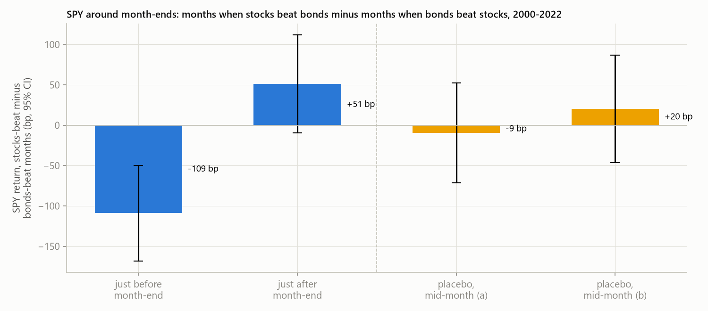
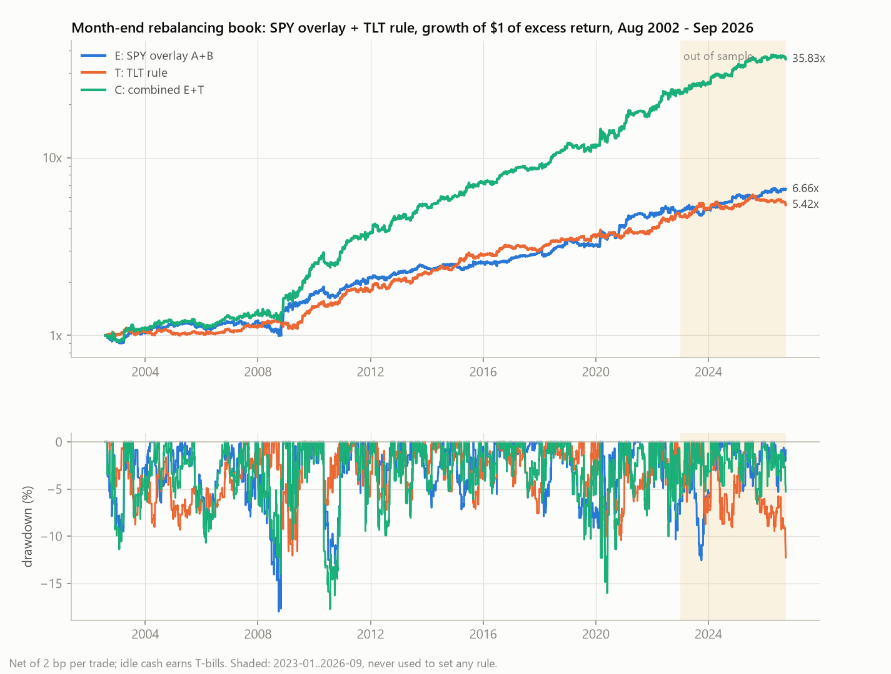
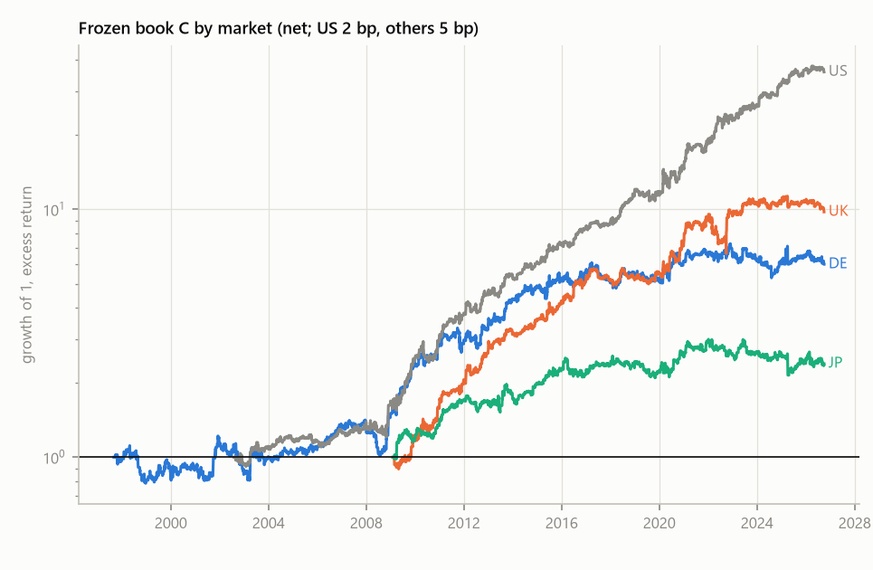
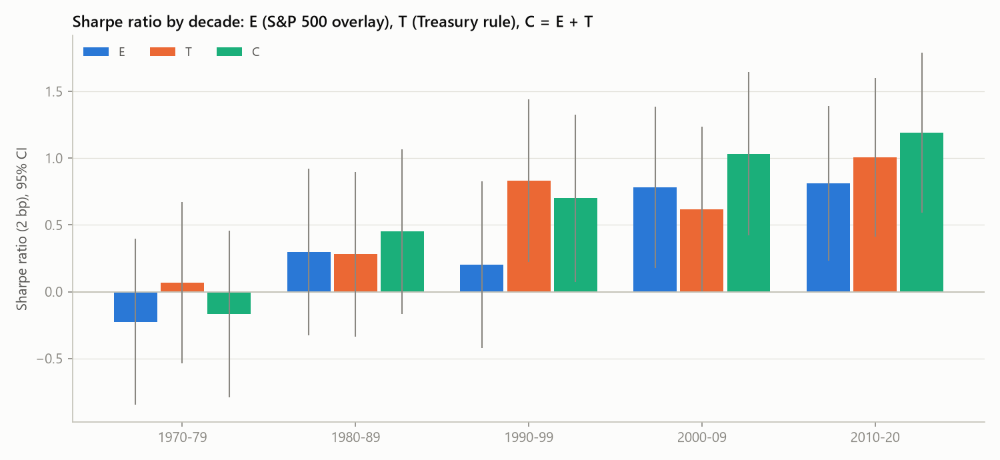
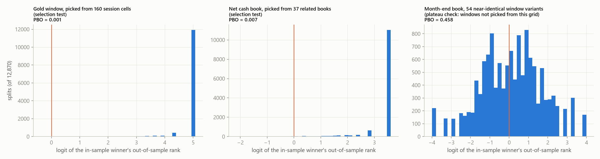

# Month-End Rebalancing Flows in Stocks and Long Treasuries: A Pre-Registered Replication, Combination and Out-of-Sample Test

*Working paper, November 2026. Personal research; not investment advice.*

## Abstract

Balanced and pension funds rebalance toward fixed stock-bond weights around month-end. Treasury index providers extend index duration on the last trading day of the month.
- **The equity side.** When stocks have beaten bonds during the month, rebalancers sell stocks into the month-end and the pressure reverses in the first days of the next month.
- **The bond side.** Long Treasuries tend to rise into the month-end.

I build two simple rules, one per leg, and check each against its own evidence:
- **Equity rule:** trades SPY in short windows just before and just after month-end, conditional on the month's stock-minus-bond return.
- **Bond rule:** long TLT into month-end, short after months in which stocks beat bonds.

The **strategy** is their combination, chosen on 2002-2022 data and tested once on January 2023 to September 2026, a period never used to set any rule. Out of sample:
- the combined book earns a Sharpe ratio of 1.09 after costs (in-sample 1.16), with a −5.9% maximum drawdown and a near-zero correlation to stocks;
- the equity leg replicates in Germany, the UK, Japan and Canada, none used in design (pooled t −4.4; Canada t −5.5);
- the bond leg is the weaker half (Sharpe 0.50 out of sample);
- the effect is absent before 2000.

Block-bootstrap, deflated-Sharpe and overfitting diagnostics support the combined book. Its exact window lengths are not material.

---

## 1. Introduction

Calendar anomalies have a bad reputation: most are found by searching many dates and fade once published. This study starts from the other end:
- a **forced trader with a deadline** (rebalancing funds at month-end, index extension on the last day);
- a **direction** fixed by the month's own returns.

That gives a prediction that can be wrong in a specific way. It also gives a clean structure for testing: each leg has a mechanism and its own evidence, and the combination is a portfolio decision that needs its own out-of-sample test.

**Contributions:**
1. **A pre-registered replication** of the equity-side rebalancing effect (Harvey, Mazzoleni & Melone 2025) on SPY 2000-2022, with a placebo.
2. **A bond rule for TLT**, built on 2002-2020 and checked on 2020-2025.
3. **A one-shot out-of-sample test** of the combined book on 2023-2026.
4. **Robustness:**
   - twelve US and Swiss pairs;
   - four countries never used in design;
   - 1970-2020 history;
   - execution timing;
   - the 2024 move to T+1 settlement.
5. **Validation and implementation:**
   - block bootstrap, probabilistic and deflated Sharpe ratios, probability of backtest overfitting;
   - costs, sizing and capacity.

## 2. Mechanism and related literature

**Rebalancing.** Funds that hold fixed stock-bond weights must sell the asset that outperformed. Much of this happens near month-end.
- **Prediction:** when stocks beat bonds month-to-date, rebalancers sell equities into the last days of the month, depressing prices, followed by a reversal once the selling stops. When bonds beat stocks, the reverse.
- Harvey, Mazzoleni & Melone (2025) document the effect and estimate its cost to rebalancers.

**Treasury month-end.** Long Treasury returns are higher at month-end (Hartley & Schwarz 2019), consistent with:
- index-extension buying by benchmarked bond funds;
- month-end liquidity needs, as with the institutional "dash for cash" in Etula, Rinne, Suominen & Vaittinen (2020).

**Turn of the month in stocks** (Ariel 1987; Lakonishok & Smidt 1988) is the unconditional version. The conditioning on the stock-bond spread is what makes the rebalancing story testable.

**Settlement timing.** Nathan, Suominen & Tasa (2026) argue that the move to T+1 settlement in May 2024 shifts liquidity-driven trading by a day. I monitor this but do not change the rules for it (Section 7).

## 3. Data and protocol

**Data:**
- SPY total returns (Compustat daily with dividend factors, extended with Yahoo Finance from May 2026);
- TLT adjusted returns from August 2002, and a 20-year constant-maturity Treasury proxy before that;
- three-month T-bills (FRED DTB3).

All results are in excess of T-bills.

**Calendar:**
- trading days are counted from the month-end: day −1 is the last trading day, day +1 the first of the next month;
- signals are read at a close and traded at the next close;
- costs are 2 bp one-way per unit traded, fixed in advance (4 bp in Section 8).

**Protocol** (see [METHODOLOGY](../METHODOLOGY.md)):
- Every step had a written plan, committed before its first number existed. The plan stated the hypothesis, the primary test, its pass mark, the reading rule and my expectations.
- Every variant tried is reported (Appendix).

## 4. The rules

**Signal S.** The month-to-date return of SPY minus long Treasuries, read a few trading days before month-end.

| Leg | Window | Position |
|---|---|---|
| Equity A | a short window ending on the last trading day | short SPY if S > 0 (stocks beat bonds), long otherwise |
| Equity B | a short window at the start of the next month | long SPY if S > 0, flat otherwise |
| Bond, long | a short window ending on the last trading day | long TLT every month |
| Bond, short | a short window at the start of the next month | short TLT if S > 0 |

The window lengths, the signal day and the live sizing are not disclosed.

- The equity book **E** is A + B; the bond book **T** is its two legs.
- The **combined book C = E + T** holds each at 1× notional and holds cash outside the windows.

## 5. Evidence for each leg

### 5.1 The equity leg (EDA, 2000-2022)

Plan committed 2026-10-05, before any data was loaded.
- **Prediction:** just before month-end, SPY returns are lower in stocks-beat-bonds months (primary test R1). Just after, they reverse (R2).
- **Placebo:** the same split moved to two mid-month windows should show nothing.

**Result:**
- **R1:** −20 bp vs +89 bp, a difference of −109 bp (t −3.6).
- **R2:** +53 bp vs +2 bp (t 1.65).
- **Placebo windows:** flat.
- The equity book E earns a Sharpe of 0.79 on 2002-2022.

This is a replication: 2000-2022 lies inside the original paper's sample.

### 5.2 The bond leg (2002-2020, then 2020-2025)

**Design, 2002-2020:**
- On 2002-2020, TLT rose into month-end: long-only Sharpe 0.76.
- It fell in the first days of the next month, mostly after months in which stocks beat bonds.
- The rule above (long into month-end; short after stock-outperformance months) has a Sharpe of 0.89 on 2002-2020.

**First check, 2020-2025:**
- The every-month short disappeared (−17 bp per window, t −0.5).
- The conditional short held up more weakly (−49 bp, t −1.2).
- The rule as a whole earned a Sharpe of 0.79.
- I kept the conditional version, which had been chosen on 2002-2020.
- Within the combination's test window (2023-2026, Section 6), the bond rule earned a Sharpe of 0.50, weaker than in design.

**A related refinement failed:** exiting early at quarter-ends was rejected on a 1977-2001 hold-out.

## 6. The combination and its out-of-sample test

By 2022 each leg had its own evidence. The open question was whether the **combined book** made sense as a strategy, i.e. whether the two legs add up to something better than either alone.

That is a portfolio decision. I made it on 2002-2022 data and then tested it once.
- **Plan:** written 2026-10-05.
- **Out of sample:** 2023-01..2026-09, never used to set any rule.
- **Success criterion:** C positive with Sharpe > 0 out of sample.

| Period | Book | Excess return | Volatility | Sharpe | Max drawdown | FF6 alpha (t) |
|---|---|---|---|---|---|---|
| In-sample 2002-08..2022 | E | 8.5% | 10.8% | 0.79 | −16.9% | 7.0% (3.1) |
| | T | 7.9% | 8.5% | 0.93 | −11.9% | 8.2% (4.4) |
| | **C** | **16.4%** | 14.1% | **1.16** | −17.7% | 15.2% (5.0) |
| | SPY | 9.6% | 19.4% | 0.50 | −55.2% | |
| **Out of sample 2023-01..2026-09** | E | 8.0% | 7.9% | 1.01 | −10.5% | 6.5% (1.6) |
| | T | 4.4% | 9.0% | 0.50 | −8.3% | 4.9% (1.1) |
| | **C** | **12.4%** | 11.4% | **1.09** | **−5.9%** | **11.4% (2.2)** |
| | SPY | 16.3% | 14.9% | 1.09 | −18.8% | |

All figures are net of 2 bp per trade.

**Findings:**
- **The combination passed:** out of sample, C kept 94% of its in-sample Sharpe.
- **It helps:** C's drawdown (−5.9%) was smaller than either leg's (−10.5% and −8.3%), because the legs are nearly independent.
- **Within C, the equity leg carried the result** out of sample; the bond leg was weaker, consistent with Section 5.2.
- **Next to SPY:** SPY-plus-C ("portable alpha": SPY held through futures, C on top) reached a Sharpe of 1.45 against SPY's 1.09 over the same months.

## 7. Robustness

**Other pairs.**
- The same rules on twelve pairs (QQQ, IWM, intermediate Treasuries, the Swiss market and Swiss bonds, among others) replicate the equity leg everywhere.
- The bond leg does not carry over to Swiss bonds.
- The US pairs are 0.7-1.0 correlated, so they are robustness checks, not independent evidence.

**New countries.** These were never used in design, and the frozen book was applied unchanged.

| Market | Sample | Equity leg A: stocks-beat minus bonds-beat (t) | C Sharpe |
|---|---|---|---|
| Germany | 1997- | t −3.0 | 0.47 |
| United Kingdom | 2009- | t −3.8 | 0.97 |
| Japan | 2009- | t −2.1 | 0.46 |
| Pooled (DE, UK, JP) | | −91 bp (t −4.4) | 0.94 |
| Canada | 2001- | −127 bp (t −5.5) | 1.25 |

Outside the US, C weakened after 2020 (Sharpe 0.14-0.59).

**History.** Before 2000 there is no equity effect: C's Sharpe is 0.34 in 1970-1999 against 1.12 in 2000-2020. This is consistent with the growth of balanced, target-date and other fixed-weight vehicles. It is also the main warning: the effect depends on who is in the market.

**Timing.** Reading the signal a day earlier than in the test, which leaves time to trade, loses nothing.

**Which stocks.** Among the largest 500 stocks, every stock moves by about the same percentage. This fits an index-level flow and no stock characteristic.

**T+1 settlement (since May 2024).**
- C's Sharpe is 1.48 in the T+2 era and 0.97 over the first 28 months of T+1.
- The bond short has been negative since (−23 bp a month, t −1.5).
- I monitor this and have not changed any rule: changing a window because of 28 months would be fitting.

## 8. Validation

**Block bootstrap.** Under the live timing at 4 bp (stationary bootstrap, 21-day blocks):

| Sample | Sharpe | 95% interval | P(Sharpe ≤ 0) |
|---|---|---|---|
| 2002-2026 | 1.07 | 0.72 to 1.44 | 0.0% |
| Out of sample 2023-26 | 0.92 | 0.11 to 1.70 | 1.3% |

**Probabilistic and deflated Sharpe.**
- The out-of-sample PSR(0) is 0.96.
- The deflated Sharpe on the full sample is 0.999 at a broad count of about 50 trials from the research record, and 0.993 at 250.
- Measured on the 54 neighbouring rules below, which are 0.7 correlated on average, the effective number of independent trials is about 2, and the deflated Sharpe is 1.00.

**Probability of backtest overfitting.** The windows were taken from the literature, not selected from a grid (the rule ranks 6th of 54 neighbours), so PBO is used here as a plateau check, not a test of the selection. Combinatorially symmetric cross-validation over 54 neighbouring rules (shorter and longer windows for each leg; bond short on or off) gives PBO 0.46.
- Near 0.5, because the neighbours are nearly identical and which is best is noise.
- But the in-sample best never lost money out of sample in any of 12,870 splits.
- So the exact window does not matter; the family works.

## 9. Implementation

**Costs.**
- Executed with market-on-close orders on the ETFs (or micro futures), realistic costs are 0.1-0.5 bp one-way.
- At a deliberately harsh 4 bp, C's Sharpe is 1.07 over 2002-2026.

**Size.** At 0.75× per leg, C runs at about 10% volatility, with a worst month of −9.4% in the backtest.

**Capacity.** TLT trades about $3 billion a day. Limiting each leg to 1% of a quiet day's volume supports roughly $20 million per leg; the SPY leg is not a constraint.

**Combining with equities.** C's correlation with SPY is about zero. A 50/50 mix of SPY and C has a monthly Sharpe of 1.61 since 2016 and 1.82 in 2023-2026, the only stretch out of sample for C.

The live sizing, the stop-trading rule and later refinements tested on the new countries are not disclosed here.

## 10. Limitations

- **No effect before 2000.** The flow that drives the equity leg is recent and could shrink as fast as it grew.
- **The result is published**, so arbitrage could erode it.
- **The bond leg is the weak part:** a Sharpe of 0.50 out of sample and a weaker short since T+1.
- **The out-of-sample period is short** (3.75 years). The Sharpe interval runs from about 0.1 to 1.7.
- **Returns are lumpy.** A few volatile months (2008-2010, 2020) contribute a large share of the history.

**What would change my mind:** the equity-leg spread (stocks-beat minus bonds-beat just before month-end) turning non-negative over the next three years, in the US and the pooled new countries alike.

## 11. Conclusion

A rebalancing flow with a deadline and a known direction produces a month-end pattern in SPY that:
- replicates in-sample;
- survives a one-shot out-of-sample test as part of a stock-bond book;
- appears in four countries never used to design it.

The bond leg adds diversification but is the less reliable half. The combined book's out-of-sample record is short and its pre-2000 history is flat. So the right description is a **live candidate with a known mechanism**, not a proven anomaly. It is being paper-traded with a stop-trading rule fixed in advance.

## Appendix: everything tried

| Idea | Outcome |
|---|---|
| TLT turn of the month, long into month-end (2002-20) | Sharpe 0.76; kept |
| Every-month short at the start of the month | Failed after 2020 (t −0.5); dropped |
| A shorter start-of-month short (chosen after seeing 2002-20) | Not adopted: best of 10 windows, overfit risk |
| Conditional short after stocks beat bonds | Kept; weaker after 2020 (t −1.2) |
| Quarter-end early exit | Failed its 1977-2001 hold-out |
| Equity rebalancing overlay (E), primary R1 / R2 | R1 t −3.6, R2 t 1.65; placebo flat |
| End-of-month losers (cross-section) | No evidence |
| Dividend-month premium (cross-section) | Primary test failed (t 1.46) |
| Pre-turn-of-month loser short (T+1 paper) | Failed (t −1.76) |
| Which stocks react (top 500) | No characteristic; same percentage move |
| Combined book C, one-shot test 2023-26 | Passed (Sharpe 1.09) |
| Twelve pairs; four new countries; 1970-2020 | Equity leg replicates; none before 2000 |
| Five pre-set variants judged on new countries; two leg-B variants judged on Canada | Some adopted, some rejected (not disclosed) |

## References

- Ariel, R. (1987). A monthly effect in stock returns. *Journal of Financial Economics* 18, 161-174.
- Bailey, D. H., & López de Prado, M. (2014). The deflated Sharpe ratio. *Journal of Portfolio Management* 40(5).
- Bailey, D. H., Borwein, J., López de Prado, M., & Zhu, Q. J. (2017). The probability of backtest overfitting. *Journal of Computational Finance* 20(4).
- Etula, E., Rinne, K., Suominen, M., & Vaittinen, L. (2020). Dash for cash: Monthly market impact of institutional liquidity needs. *Review of Financial Studies* 33(1), 75-111.
- Hartley, J., & Schwarz, K. (2019). Predictable end-of-month Treasury returns. Working paper.
- Harvey, C. R., Mazzoleni, M. G., & Melone, A. (2025). The unintended consequences of rebalancing. NBER Working Paper 33554.
- Lakonishok, J., & Smidt, S. (1988). Are seasonal anomalies real? A ninety-year perspective. *Review of Financial Studies* 1(4).
- Nathan, D., Suominen, M., & Tasa, J. (2026). The intramonth momentum cycle. Working paper.
- Politis, D. N., & Romano, J. P. (1994). The stationary bootstrap. *Journal of the American Statistical Association* 89.
