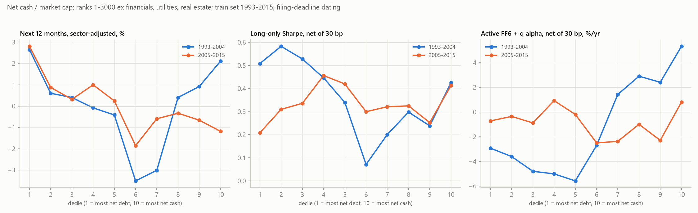
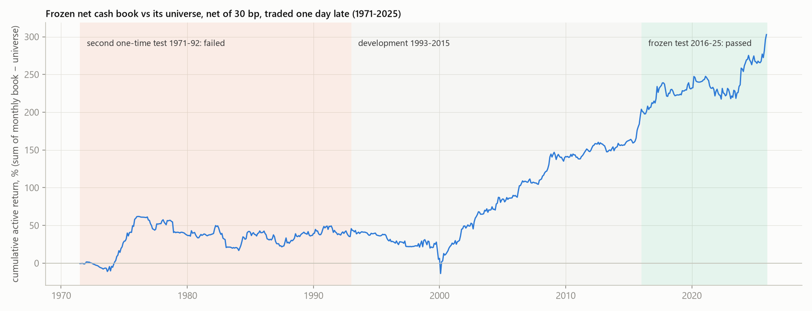

# Cash-Rich, Cash-Generating Stocks: A Frozen Out-of-Sample Pass, a Failed Early-Sample Test, and What Survives Costs

*Working paper, November 2026. Developed within a university course project. Personal research; not investment advice.*

## Abstract

I study US stocks whose net cash (cash minus debt) is a large share of their market value, whose cash covers all their liabilities, and which still generate free cash flow.

**Development (1993-2015):**
- Net cash relative to market value is **not** a cross-sectional signal on its own: the decile spread is −2.1% a year, t −1.1.
- But a thin extreme group, cash-rich and cash-generating, earns a large, short-lived rebound after falls.

**Two one-time tests of a book frozen from that work:**
- **2016-2025: passes.** Active FF6 + q alpha +13.8% a year (t 2.46), and it adds to an existing stock book (t 2.64).
- **1971-1992: fails.** +2.0%, t 0.86, with two years carrying most of it.

**Robustness and limits:**
- The pass survives realistic spreads (+11.7%, t 2.1) but not size: capacity is below about $1M under a conservative impact rule.
- The book holds about seven names and has a −45% drawdown.
- All the evidence comes from after 2000.

My reading: a real but fragile small-account effect, worth holding only as a small sleeve.

---

## 1. Introduction

Firms holding more cash than debt, enough to pay every liability and still profitable, have a floor under their value: cash on the balance sheet. When such a firm's price falls toward that floor, one might expect the market to correct.

The question is whether this shows up in returns after realistic costs, and whether it survives tests on data that played no part in designing it.

The paper is also a case study in a failure mode: **a good out-of-sample result that a second, older out-of-sample window does not confirm.** I report both.

## 2. Data

**Sources:**
- Compustat quarterly fundamentals and CRSP-based daily and monthly returns, 1971-2026.
- Fundamentals are dated by their filing deadline: the later of the announcement and quarter end + 45 days (+ 90 for fiscal Q4). They go stale after 270 days.

**Universe:** each month, the 3,000 largest US common stocks, excluding financials, utilities and real estate.

**Benchmark and costs:**
- returns are measured against the universe's equal-weighted book at the same timing (active returns);
- alphas are on the Fama-French six factors plus the q-factors (Hou, Xue & Zhang 2015), with Newey-West errors;
- costs are 30 bp per unit traded, with a 60 bp stress.

## 3. Development on 1993-2015

**Plan.** Written before any result: deciles of net cash / market value, Fama-MacBeth regressions with standard controls, and long and long-short books. The pass rule required consistent signs in both halves (1993-2004, 2005-2015).

**Result 1: not a signal.**
- The most-net-cash decile minus the most-net-debt decile earns −2.1% over 12 months (t −1.1). The rule passed 0 of 2 criteria.
- The profile is a V, not a line: within net-cash firms more cash pays, within net-debt firms more debt pays.
- **The largest split is free-cash-flow sign, in every decile.** Firms burning cash do badly.

*Deciles of net cash / market value on 1993-2015, by half. No consistent line: the most-net-cash decile is strong in 1993-2004 and weak in 2005-2015.*

**Result 2: the extreme group looked too good, so it was checked hard.**
- Firms with net cash above a high fraction of market value had an alpha of +10.5% (t 3.6). The threshold was a natural cut set on name counts before returns were read.
- Adding positive free cash flow raised the Sharpe to 1.02.

| Check | What it found |
|---|---|
| Industry | Managed-care insurers were 39% of the group's return. Their "cash" is policyholders' money. A **liability test** (cash must cover total liabilities) removes them and similar float businesses. |
| Timing | About half the alpha came from stocks that had just fallen. Trading **one day late** keeps +9.2% (t 3.7); at five days late, +6.9%. The rebound is mostly capturable. |
| Horizon | Half of the 12-month return arrives in the first month. This is a short-lived rebound of cash-rich names after falls, not a slow deep-value payoff. |
| Thinness | About 13 names on average; too few names in 55 of 276 months. |

**Three choices were made after seeing results** (free-cash-flow sign, liability test, one-day delay). They are disclosed and counted in the deflated Sharpe below.

## 4. The frozen book

**The book:**
- Holds every universe firm with net cash above the threshold, cash covering total liabilities, and positive trailing free cash flow.
- Equal-weighted, rebalanced monthly, traded at the close one day after formation.
- When too few firms qualify, it holds a broad equal-weight band of mid-caps instead. For a small account it holds SPY.
- 30 bp per unit traded.

**Go / no-go bars before the test,** fixed in advance and checked without reading any test-window return:
- enough strength on the training set to make a pass possible;
- enough test months with a minimum number of names;
- data coverage.

**Primary tests,** one-sided and run once, in order:
- **T1:** active FF6 + q alpha.
- **T2:** active alpha beyond an existing filtered stock book.

## 5. Test 1: 2016-2025 (passes)

| Test, net of 30 bp, one day late | Alpha %/yr | t | p |
|---|---|---|---|
| T1: active FF6 + q | **+13.8** | **2.46** | 0.007 |
| T2: beyond the existing book | **+14.6** | **2.64** | 0.004 |

**My stated expectation was a narrow fail** (+3-6%, t about 1-1.5). A pass is checked as hard as a fail, with checks written after reading the test and before computing them:

| Check | Alpha %/yr (t) |
|---|---|
| Frozen book: Sharpe 0.74, max drawdown −45%, about 7 names | +13.8 (2.5) |
| Market cap over all share classes | +14.0 (2.15) |
| Without biotech | +10.4 (2.55) |
| Without the largest contributor | +11.9 (2.4) |
| Without the 5 largest and 5 smallest contributors | +12.3 (2.25) |
| Without the 5 largest contributors | +9.7 (1.8) |
| Without the 10 largest contributors | +4.9 (1.0) |
| Random same-size books (2,000 draws) | 1.5% of draws match the real result |

**Reading:**
- The pass survives the share-class correction, a symmetric trim and a random-book null.
- But it is concentrated: the ten best names carry most of it.

## 6. Test 2: 1971-1992 (fails)

**Design:** the same frozen book, tested once on the older data, which no net-cash work had touched.

| Cost | Sharpe | Active FF6 + q (t) |
|---|---|---|
| Gross | 0.49 | +3.5 (1.55) |
| **30 bp** | **0.38** | **+2.0 (0.86)** |
| 60 bp | 0.28 | +0.4 (0.2) |

*Cumulative active return of the frozen book against its universe, net of 30 bp and traded one day late. Flat from the late 1970s to 2000; all the gains come after.*

**What it shows:**
- **T1 fails.** Even gross, t is below 1.645. Two years, 1974 and 1975, carry most of the return; the book beats the universe in only 7 of 22 years.
- **The signature is missing:** the first-month rebound seen in 1993-2015 and 2016-2025 is absent in 1982-1992.
- **Across all windows (frozen book, 30 bp):**

| Window | Active FF6 + q (t) |
|---|---|
| 1971-1992 | +2.0 (0.86) |
| 1993-1999 | −5.7 (−1.3) |
| 1993-2015 | +7.4 (3.1), coming from 2001 on |
| 2016-2025 | +13.8 (2.46) |

- **So the evidence comes entirely from after 2000.** Two explanations fit, and this test cannot separate them:
  - a real change in the market: decimalisation in 2001 cut trading costs, and capital may have left small cheap stocks;
  - a design fitted to 2001-2015, with 2016-2025 partly luck.
- **What does hold in every era is the simpler fact:** firms with positive free cash flow beat those without (active +2.5%, t 4.8, in 1971-1992).

## 7. Costs and capacity

**Spreads.** I re-priced every trade with half-spreads estimated from daily price ranges and an impact model. The base estimate is about 59 bp a unit, likely conservative for the larger names.

| Cost model, 2016-2025 | Cost per unit | Sharpe | Active FF6 + q (t) |
|---|---|---|---|
| Flat (the test) | 30 bp | 0.74 | +13.8 (2.5) |
| Estimated spreads | 59 bp | 0.64 | +11.7 (2.1) |
| Conservative spreads | 66 bp | 0.62 | +11.2 (2.0) |

**Capacity:**
- The median holding trades about $3.6M a day, and 10% of holdings under $0.6M.
- With a square-root impact rule (coefficient 1), alpha is gone by about $5M and t falls below 1.645 at any size.
- With a lower published impact model (Frazzini, Israel & Moskowitz 2018) it holds to about $10M.
- **Either way, this is a small-account effect.**

**A small account** (SPY in thin months, conservative costs, $1 per order), simulated at sizes from $12.5k to $200k, 2016-2025:
- Sharpe 0.64-0.67, CAGR 16-17%, max drawdown −45% to −46%;
- about 100 orders a year;
- broker fees from about 0.8% a year at the smallest size to under 0.1% at the largest.

## 8. Validation

| Statistic | Value |
|---|---|
| Sharpe 2016-2025, 95% stationary-bootstrap interval (small-account version, excess of T-bills) | 0.67 (0.08 to 1.26) |
| Probabilistic Sharpe > 0, 2016-2025 | 0.985 |
| Deflated Sharpe, 1993-2026, at the measured independent trials of its 37-book family (about 3) | 0.999 |
| Deflated Sharpe, 1993-2026, at a broad count including earlier studies on the same universe (about 200) | 0.854 |
| Probability of backtest overfitting, 37 related books, 1993-2015 | 0.007 |

**Reading:**
- Within the development years, the best book in one half is reliably near the top in the other (low PBO).
- The 37 related books behave like about 3 independent bets, so the measured deflation is mild.
- But the book came out of a longer line of studies on the same universe, and at that broader count the deflated Sharpe is below 0.95.
- Together with the failed 1971-1992 test, that says the full-history Sharpe overstates what can be expected.

## 9. Limitations

- **Concentration:** about seven names, and the ten best names carry most of the result. A −45% drawdown with 39 months underwater.
- **Era dependence:** nothing before 2001.
- **Capacity:** small-account only, and the real spreads in these names after 2000 cannot be measured with the data available.
- **Data:** restated fundamentals; no delisting returns (a −30% stress on last returns barely changes the result).

## 10. Conclusion

A popular intuition, that cash-rich stocks are mispriced, does not hold as a broad signal. A narrow version, cash-rich and cash-generating firms after a fall, passed a frozen ten-year test after realistic spreads, then failed on 1971-1992.

The honest description is a **post-2000, small-account, concentrated effect** that may be real, may be partly luck, and is worth holding only as a small sleeve next to more robust books.

## Appendix: what was tried before the decision

- **Deciles of net cash / market value, cash / market value, debt / market value; Fama-MacBeth with controls.** No signal; the V shape described in Section 3.
- **Natural groups** (net debt, net cash, very high net cash), free-cash-flow splits inside each decile, next to an existing stock book.
- **Checks on the extreme group:** industry, last month's price, quarterly sleeves, delisting stress, share classes, one- and five-day delays, horizons.
- **Two frozen one-time tests (2016-2025 and 1971-1992), a spread and capacity study, and a small-account study.**
- **Later personal-account variants** (a wider industry-neutral book, quality fixes, risk overlays) came after this decision and are not covered here.

## References

- Bailey, D. H., & López de Prado, M. (2014). The deflated Sharpe ratio. *Journal of Portfolio Management* 40(5).
- Fama, E. F., & French, K. R. (2015). A five-factor asset pricing model. *Journal of Financial Economics* 116(1).
- Frazzini, A., Israel, R., & Moskowitz, T. J. (2018). Trading costs. Working paper.
- Hou, K., Xue, C., & Zhang, L. (2015). Digesting anomalies: An investment approach. *Review of Financial Studies* 28(3).
